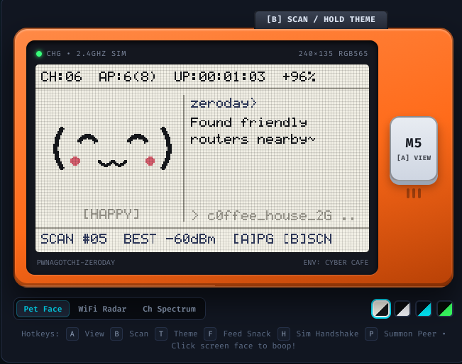

# pwnagotchi-zeroday
Pwnagotchi, our way zero day

<p align="center">
  
</p>

A cross-platform Pwnagotchi-inspired virtual pet UI and 2.4 GHz WiFi scanner written in portable **C++17**, built around a **Functional Core, Imperative Shell** architecture that runs across **ESP32 / M5Stack handhelds**, **native desktop / Linux SBC terminals**, a full **Linux desktop app (CLI/TUI + Qt6 GUI) with real offensive & defensive WiFi tooling**, and the **browser**.

---

## Features

- **10 Original, Trademark-Clean Themes**: Cycle forward and backward through `Paper Ink`, `Dark Ink`, `ZeroDay`, `Phosphor`, `Neon Noir` (magenta/cyan neon nightlife), `Neon Volt` (acid-yellow/cyan visor), `Operator` (cobalt-blue & steel security workstation), `Red Team` (night-ops red), `Amber CRT`, and `Sunset Grid` — complete with an on-screen toast overlay, pet reactions, and NVS/local persistence. See [docs/THEMES.md](docs/THEMES.md).
- **Expressive Pwnagotchi-Style Faces**: Crisp vector/pixel expressions (`Awake`, `LookingLeft`, `LookingRight`, `Happy`, `Excited`, `Cool`, `Lonely`, `Bored`, `Sleepy`) rendered tear-free via `zd::render::paintUiFrame`.
- **Non-Blocking WiFi Scanning**: Pure functional scan pipeline sanitizes SSIDs, deduplicates mesh BSSIDs, builds channel 1–13 histograms, and drives mood & commentary without blocking animations or inputs.
- **Three Switchable Views**:
  1. **Pet Face View**: Split layout with animated face, mood badge, word-wrapped `zeroday>` status phrase, strongest SSID spotlight, and telemetry bars.
  2. **Nearby WiFi Radar**: Top deduplicated access points sorted by RSSI with 4-bar signal meters, security indicator (`*`), channel, and dBm readout.
  3. **Channel Spectrum**: 2.4 GHz channels 1–13 bar histogram with open vs. secured AP counts.
- **Multi-Device Responsive Layout**: Automatically scales from `128×64` micro OLEDs and `160×80` M5StickC up through `240×135` StickC Plus2 / Cardputer, `250×122` 2.13" e-Paper HATs, and `320×240`+ QVGA cyberdecks (`M5Stack Core2`, `CYD`, `T-Deck`), including built-in RGB565, RGB888, and 1-bit monochrome framebuffer export. See [docs/PORTING.md](docs/PORTING.md).
- **Linux Desktop App — Real Offensive & Defensive WiFi Tooling**: A CLI/ncurses TUI (`zd-linux`) and a Qt6 GUI (`zd-gui`) over a shared controller. Unprivileged recon (nmcli/iw), live **defensive monitors** (deauth-flood, evil-twin, open-downgrade, karma-beacon detection), and **authorization-gated offensive** capture (WPA handshakes / PMKIDs) and deauth injection via a hybrid **libpcap + aircrack-ng** backend. Every transmit is gated by an explicit authorization + per-BSSID allow-list and written to an audit log. See [docs/LINUX.md](docs/LINUX.md).

---

## Cross-Platform Repository Layout

```text
core/include/zd/              # Zero-dependency C++17 Functional Core & HAL
  ├── fp.hpp                  # Higher-order combinators & stateless xorshift32 PRNG
  ├── domain.hpp              # Immutable AppState, ThemeId & semantic AppEvents
  ├── theme.hpp               # Single-source-of-truth 10-theme catalog & color helpers
  ├── wifi_analysis.hpp       # Pure scan sanitization, deduplication & histograms
  ├── pet_logic.hpp           # Pure Elm/Redux reducer: reduce(AppState, AppEvent)
  ├── ui_model.hpp            # Responsive multi-device layout & ASCII frame renderer
  ├── hal.hpp                 # Portable HAL interfaces, CLI parser & PlatformSession
  ├── secops.hpp              # Pure security engine: SecState reducer, defensive monitors,
  │                           #   and the transmit authorization gate
  └── secops_hal.hpp          # Capture/inject/monitor adapter contracts & SecSession
render/include/zd/render/     # Hardware-agnostic immediate-mode renderer
  ├── painter.hpp             # Templated paintUiFrame<Gfx> (M5GFX, LovyanGFX, etc.)
  └── surface_rgb565.hpp      # Zero-dep RGB565 framebuffer + 5x7 font + 1-bit export
platforms/                    # Device & OS shells
  ├── m5stick/main.cpp        # ESP32 + M5Unified + WiFi + NVS Preferences + Serial CLI
  ├── tdeck/main.cpp          # ESP32-S3 + LovyanGFX + Trackball + Touch + Keyboard + GPS
  ├── native/main.cpp         # Desktop / Linux / RPi CLI simulator & PPM exporter (zd_sim)
  ├── linux/                  # Linux desktop app: real offensive/defensive WiFi tooling
  │   ├── backend/            #   hybrid libpcap/libnl + CLI-tool adapters & pure parsers
  │   ├── app/                #   shared AppController + monotonic clock
  │   ├── cli/main.cpp        #   ncurses TUI + scriptable subcommands (zd-linux)
  │   └── gui/                #   Qt6 Widgets dashboard (zd-gui)
  └── web/                    # Standalone HTML5 Canvas pocket cyberdeck port
tests/                        # Automated host & cross-language parity test suites
docs/                         # Theme design rules (THEMES.md) & porting guide (PORTING.md)
```

---

## Controls

### M5Stack / M5Stick Handhelds
| Input | Action |
| :--- | :--- |
| **Button A (Front `M5`)** / `A` | Cycle screen views (`Pet Face` -> `WiFi Radar` -> `Channel Spectrum`) & wake pet |
| **Button B (Short press)** / `B` | Trigger an immediate WiFi scan |
| **Button B (Hold ~0.7s)** / `T` | Cycle to **next** theme (shows toast & persists to flash/storage) |
| **Power Click or Button C** / `Shift+T` | Cycle to **previous** theme |

### LILYGO T-Deck / T-Deck Plus Portable Cyberdecks
| Input | Action |
| :--- | :--- |
| **Trackball Click (GPIO 0)** / `Space` | Cycle screen views (`Pet Face` -> `WiFi Radar` -> `Channel Spectrum`) & wake pet |
| **Trackball Hold (~0.6s)** / `Enter` | Trigger an immediate WiFi scan |
| **Trackball Up / Down** | Cycle screen views backward / forward |
| **Trackball Left / Right** | Cycle themes backward / forward (shows toast & persists to NVS) |
| **GT911 Touchscreen** (T-Deck Plus) | Tap top bar to cycle theme; tap left/right third to cycle views; tap center to scan/wake |
| **QWERTY Keyboard Hotkeys** | `Space`/`Tab`: cycle views; `Enter`: immediate scan; `1`/`2`/`3`: jump to Face/Radar/Spectrum |
| **Keyboard / Serial CLI** | Interactive typing: `theme neon`, `theme prev`, `themes`, `view next`, `scan`, `status`, `gps` |
| **MIA-M10Q GPS** (T-Deck Plus) | Real-time GNSS coordinate & satellite acquisition; queried via `gps` command or telemetry |

---

## Quick Flashing Prebuilt Binaries (Canary Releases)

Precompiled firmware and desktop binaries are built automatically on every commit and available on the **[Releases Tab](https://github.com/DancinGhost/pwnagotchi-zeroday/releases)** under `canary`.

- **In-Browser Web Flasher (Zero Software Installation)**: Open [Espressif Web Flasher](https://espressif.github.io/esptool-js/) in Chrome/Edge, connect your board, set offset to `0x0`, and flash `pwnagotchi-zd-*-factory.bin`.
- **One-Click Local Flasher**: Download the release zip for your board and run `./flash.sh` (Linux/macOS) or `flash.bat` (Windows).
- See [docs/FLASHING.md](docs/FLASHING.md) for step-by-step instructions across all devices.

---

## Building & Running

### 1. Embedded Firmware (PlatformIO)

```bash
# LILYGO T-Deck Plus / Portable Plus (ESP32-S3, 320x240 ST7789, Touch, Keyboard, GPS)
pio run -e t-deck-plus --target upload

# Standard LILYGO T-Deck
pio run -e t-deck --target upload

# M5StickC (160x80) / M5StickC Plus (240x135)
pio run -e m5stick-c --target upload

# M5StickC Plus2 (240x135, 8MB Flash)
pio run -e m5stick-c-plus2 --target upload

# M5Stack Core2 (320x240 QVGA)
pio run -e m5stack-core2 --target upload

# Serial monitor + interactive CLI (try typing: themes, theme neon, gps, status)
pio device monitor -b 115200
```

### 2. Native Desktop / Linux Simulator (`zd_sim`) & Unit Tests

Build and run all C++ core tests, software framebuffer/HAL tests, and Web/C++ parity tests with `make` (or `cmake`):

```bash
make test
```

Preview every theme in truecolor ANSI right in your terminal, or export a pixel-accurate `.ppm` screenshot for any device profile (`micro`, `compact`, `plus`, `epaper`, `wide`):

```bash
make demo
./build/zd_sim --theme neon --size plus
./build/zd_sim --theme operator --size wide --ppm build/operator_wide.ppm
```

With CMake + CTest:

```bash
cmake -B build && cmake --build build && ctest --test-dir build --output-on-failure
```

### 3. Linux Desktop App — CLI/TUI + Qt6 GUI (real offensive/defensive tooling)

Build both front-ends and run the full host test suite (requires `qt6-base-dev`, `libpcap-dev`,
`libncurses-dev`, `cmake`; active features use the `aircrack-ng` suite + `iw`/`nmcli`):

```bash
sudo apt install cmake pkg-config qt6-base-dev libpcap-dev libncurses-dev \
                 aircrack-ng iw network-manager
cmake -B build_cmake && cmake --build build_cmake -j
ctest --test-dir build_cmake --output-on-failure

./build_cmake/zd-linux scan            # unprivileged recon: live network table
sudo ./build_cmake/zd-linux watch      # monitor mode: stream defensive alerts
./build_cmake/zd-gui                    # Qt6 desktop dashboard
```

> ⚠️ **Authorized use only.** Monitor mode + deauth require root and a monitor-capable adapter.
> Deauth injection is refused unless you both confirm authorization **and** allow-list the target
> BSSID, and every transmit is written to an audit log. Only test networks you own or are
> explicitly authorized to assess. Full details & safety model: [docs/LINUX.md](docs/LINUX.md).

### 4. Web Port (Browser Pocket Cyberdeck)

Open [`platforms/web/index.html`](platforms/web/index.html) directly in any browser (`file://` works with zero build step), or serve locally:

```bash
make web-serve
# Visit http://localhost:8080
```

Run the Web Port & C++ theme catalog parity tests directly with Node.js:

```bash
node platforms/web/test_web_core.js
```

---

See [ROADMAP.md](ROADMAP.md) for planned features across every platform.

---

## License & Legal

- Source code: [MIT License](LICENSE). Third-party components linked into the release binaries
  (Arduino-ESP32 / LGPL-2.1, ESP-IDF / Apache-2.0, M5Unified, M5GFX, LovyanGFX, Qt 6 / LGPL-3.0,
  libpcap, ncurses) are listed in [THIRD_PARTY_NOTICES.md](THIRD_PARTY_NOTICES.md).
- This is an independent project **inspired by** [Pwnagotchi](https://github.com/evilsocket/pwnagotchi)
  and is not affiliated with or endorsed by it. All other product names and trademarks belong to
  their respective owners.
- **Authorized use only.** Capturing, disrupting (deauthenticating), or analyzing traffic on WiFi
  networks you do not own or lack written permission to test is illegal in most jurisdictions.
  You are solely responsible for complying with applicable laws; the software is provided "AS IS"
  without warranty, as stated in the license.
